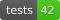

## Better Code, Better Science

[](https://doi.org/10.5281/zenodo.18603015)


[Better Code, Better Science](https://bettercodebetterscience.github.io/book/) is an open-source book on building better code for science using AI.  

Author: [Russ Poldrack](http://poldrack.github.io)

This repo contains the Python module and notebooks used for examples in the book, as well as the web version of the book.

## Building the book

The book prose lives in a **separate private repo** that is cloned into `./latex`
locally (this directory is gitignored). The targets below that read `./latex`
(`figures`, `pdf`, `site`) require it to be present. Run `make help` to list the
common targets.

First install the dependencies and this package:

```bash
make install        # uv pip install -r pyproject.toml && uv pip install -e .
```

### Regenerating the figures

Each chapter notebook sets `IMAGE_DIR = Path('../../latex/figures')` and a
`CHAPTER` number, then saves its plots with `save_fig` / `save_fig_variants`
(from `bettercode.utils` / `bettercode.figstyle`). This writes:

- **color** variants to `latex/figures/<chapter>/<name>.pdf` and `.svg`, and
- **grayscale** variants (for the print edition) to
  `latex/gray/figures/<chapter>/<name>.pdf`.

To regenerate everything:

```bash
make figures          # run all notebooks, then fill remaining gray figures
```

This runs two steps, which you can also invoke individually:

```bash
# 1. Execute every notebooks/ch-*/*.ipynb and (re)write its figures.
#    Notebooks run in this project's environment (the uv venv) by default.
uv run python scripts/run_notebooks.py

# 2. Fill grayscale variants for figures no notebook produces (hand-made
#    diagrams, screenshots) by converting the color versions, and verify
#    that every figure referenced by the .tex chapters has a gray variant.
uv run python scripts/build_gray_figures.py
```

To only verify coverage without regenerating anything:

```bash
make figures-check    # build_gray_figures --check + figure_atlas --check
```

Note that some notebooks require external data or a GPU and may be skipped or
fail on a fresh checkout; `run_notebooks.py` reports the per-notebook status and
supports `--skip PATTERN` and `--pattern` to narrow the run.

### Building the web edition (site)

The public HTML edition under `docs/` is generated from the LaTeX sources by the
`scripts/tex2qmd` pipeline (LaTeX → Quarto → HTML) and served by GitHub Pages
from `main` `/docs`. Building it requires `pandoc`, `quarto`, and `pdftocairo`
on your `PATH` in addition to `./latex`.

```bash
make site             # verify listings, convert to Quarto, render into docs/
make site-preview     # convert and launch Quarto's live preview
```

### Building the print PDF

The print PDF is built from `./latex` (delegates to `latex/Makefile`):

```bash
make pdf
```

### Running the tests

```bash
make test             # pytest with coverage over src/bettercode
```

The book is licensed according to the [Creative Commons Attribution-NonCommercial-NoDerivatives 4.0 Generic (CC BY-NC 4.0) License](https://creativecommons.org/licenses/by-nc-nd/4.0/). Please see the terms of that license for more details.  Code in this repo and code snippets in the book are licensed under the [MIT License](https://mit-license.org/).
